# Compressed solver fields (tang-compress) — M0 integration + schema proposal

Status: **M0 prototype** (app-side decode + viewer). The `.vcad` / MCP / receipt
parts below are a **proposal** — no kernel or IR changes yet.

## Why

vcad's solvers (thermal, EM, FEA, topopt, flow, stocksim SDF) emit smooth 2D/3D
scalar fields. Today they leave the solver as summary scalars or a downsampled
map, because a raw f32 grid is too big to keep in a document or ship through an
MCP result. tang-compress is an error-bounded codec for exactly this kind of
field. It is 0.67–0.72× SPERR's bits on held-out SDRBench data, and it has a
browser decoder (WebGPU, with a WASM-CPU fallback) that is byte-identical to the
native decoder. So a solver can return the **full field** with a **hard
pointwise error bound**, and the app can show it.

## M0: what exists

| piece | where |
|---|---|
| field producer | `crates/vcad-kernel-thermal/examples/dump_field.rs`: the `hot_chip` steady solve (2 W die on a 100×100×1.6 mm board, k = [15, 15, 0.4], h = 10) on a 128×128×16 grid. Writes raw f32 `(z, y, x)` °C plus a `.json` sidecar. Void voxels are pinned to the 25 °C ambient. |
| encode (offline) | tang-compress `corpus` example (TCG1 / TCG3-static / TCG3-learned) and the `tc` CLI (wavelet, max-abs mode) |
| browser decoder | `tang-compress-wasm` from `/Users/cam/Developer/tang-compress` (branch `claude/tang-compress-qtt`). It is built by `scripts/build-tc-wasm.sh` into `packages/app/public/tc-wasm/`. That folder is **gitignored, not vendored**: wasm-pack writes its own `*` `.gitignore` there. It is loaded lazily via dynamic import on first use, so the main bundle doesn't grow. |
| loader | `packages/app/src/lib/compressed-field.ts`: fetches `.tc` + `.json`, decodes (WebGPU → CPU fallback), computes FNV-1a over the f32 bits, and checks it against the native hash in the sidecar. If `.ref.f32` is present, it also measures the real max error. |
| viewer | `stores/field-overlay-store.ts` + `components/CompressedFieldOverlay.tsx`: a colormapped z-slice at its true mm position in the Z-up kernel group, the domain box, and a HUD with a slice slider, legend, error bound, hash verdict and timings. Open it with `?field=/fields/hot_chip` (add `&fieldcpu` to force the CPU path). |
| sample | `packages/app/public/fields/hot_chip.{tc,json}`: TCG3-static, max-abs 4.962e-3 °C (1e-4 × range). The `.ref.f32` reference is gitignored; regenerate it with `dump_field`. |

### Numbers (hot_chip, 16×128×128 = 262,144 cells, 1 MiB raw)

Bound = max-abs 1e-4 × range = **4.962e-3 °C** (range 25.00 → 74.62 °C).

| stream | bytes | ratio | native CPU decode |
|---|---|---|---|
| `tc` wavelet (max-abs) | 13,537 | 77× | n/a (not browser-decodable) |
| TCG1 | 30,904 | 34× | 10.4 ms |
| **TCG3-static (shipped)** | **23,480** | **45×** | 10.7 ms |
| TCG3-learned | 30,434 | 34× | 114 ms |
| TCG3-static @ 1e-3 × range | 9,602 | 109× | 10.1 ms |

The `tc` wavelet self-check reports a max error of 4.959e-3 against the 4.962e-3
bound. The streams the browser can decode (TCG1/TCG3) cost about 1.7× the bits
of the CPU-only wavelet codec at this size. That gap is the price of
GPU-parallel decode. The browser measurements are in the gate section at the end.

## Proposal: compressed fields in `.vcad` documents

A field is a *result*, not a modeling input. It goes in a new top-level `fields`
map, keyed by a stable id. Solver specs keep referencing parts as they do today.

```jsonc
"fields": {
  "thermal.hot_chip.T": {
    "quantity": "temperature",          // open vocabulary
    "units": "degC",
    "grid": {
      "kind": "regular",                // future: "octree" (stocksim), "mesh_vertex"
      "dims_zyx": [16, 128, 128],
      "origin_mm": [0, 0, 0],           // Z-up kernel frame, voxel-corner origin
      "voxel_mm": [0.78125, 0.78125, 0.1625],
      "mask": null                      // optional: ref to a bit-packed solid mask field
    },
    "range": [25.0, 74.62377],
    "codec": {
      "name": "tang-compress",
      "format": "tcg3s",                // tcg1 | tcg3s | tcg3l
      "model_fnv1a": null,              // tcg3l: fingerprint of the registered net
      "stream": { "encoding": "base64", "data": "…" }, // or { "blob": "sha256:…" }
      "bytes": 23480
    },
    "bound": { "kind": "max_abs", "value": 0.004962377 },
    "decoded_fnv1a": "e1a3021ce69b8d0d", // FNV-1a 64 over the native decode's f32 bits
    "provenance": {
      "oracle": { "id": "vcad-kernel-thermal/steady", "version": "0.10.0" },
      "spec_hash": "…",                 // hash of the resolved ThermalSpec + params
      "geometry_hash": "…"              // hash of the evaluated parts the solve consumed
    }
  }
}
```

Rules:

- **Inline only small streams.** Base64-inline up to about 256 KB per field.
  Above that, store `{ "blob": "sha256:<hex>" }` in the existing Supabase
  storage path or a side file, so documents stay diffable.
- **Stale = drop or flag, never silently show.** If `spec_hash` or
  `geometry_hash` no longer matches the document, the viewer marks the field
  *stale*, the same way `check_clearance` assertions go Stale.
- **`decoded_fnv1a` makes decode deterministic and checkable.** Any client
  (native, WASM-CPU, WebGPU) must reproduce these bits exactly. M0 shows that
  all three do.

## Proposal: MCP results

Solver tools (`solve_thermal`, `simulate_em`, `simulate_flow`,
`topology_optimize`, …) gain an opt-in `return_field: { bound?: {max_abs | max_rel}, format?: "tcg3s" }`.
The result carries a `field` object with the same shape as the document entry.
The stream goes base64 in `structuredContent` or, when large, as an artifact URL.
It is also attached to the session document under `fields`, so `save_document`
keeps it. The default bound is `max_rel 1e-4`, with the absolute value always
echoed. The inline-preview widget uses this same decoder.

## Proposal: receipt claim

The codec's guarantee is a claim like any other. It uses the open
domain vocabulary and needs no schema bump:

```jsonc
{
  "id": "field.compression.max_abs",
  "domain": "field",
  "subject": "field:thermal.hot_chip.T",
  "description": "decoded field within ±4.962e-3 degC of the solver output at every cell",
  "oracle": { "id": "tang-compress/encode-selfcheck", "version": "<crate ver>+<git sha>" },
  "basis": "verified",
  "predicted": { "value": 0.004962377, "units": "degC" },   // the bound
  "measured":  { "value": 0.0049591,   "units": "degC" },   // encoder's self-check max |Δ|
  "verdict": "pass",
  "details": "tcg3s 23480 B; decoded_fnv1a e1a3021ce69b8d0d"
}
```

- **Verified.** The encoder decodes its own stream and measures the error
  against the uncompressed solver output. That is a real oracle run, not an
  estimate. If the measured error exceeds the bound, the verdict is `fail` and
  the stream is not emitted (fail closed).
- **This claim does not grade the physics.** Compression error stacks on top of
  the solver's own claims (`vcad.thermal-claims/1`: energy residual, mesh
  convergence, predicted → Provisional). A thermal `T_max` claim read from the
  *decoded* field must widen its tolerance by the bound. `verify_receipt` can
  re-check this claim by re-decoding the stream and comparing against
  `decoded_fnv1a`. It cannot re-measure |Δ| without the raw field, so on
  re-verify the claim becomes *Holds* (hash matches) or *Violated* (bits
  changed).
- **Pair with a second claim:** `field.decode.deterministic`, verdict pass when
  the client's decode hash equals `decoded_fnv1a`. This is the M0 browser
  gate, written as a receipt line.

## M0 gate (2026-10-20, M4, Chrome in the Claude desktop browser pane)

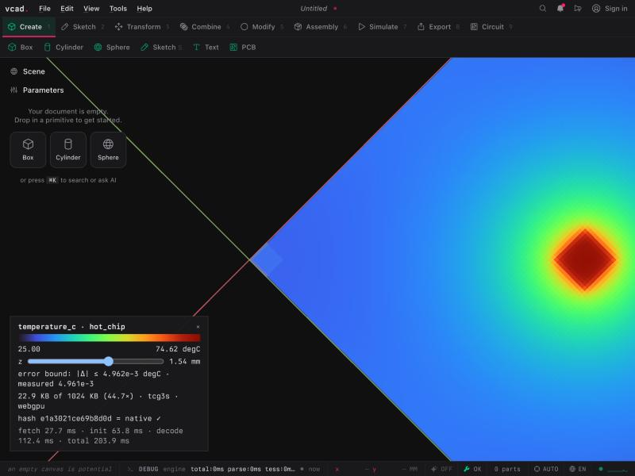

The stream is `hot_chip.tc` (TCG3-static, 23,480 B for 262,144 cells, 45×).

| check | WebGPU | WASM CPU |
|---|---|---|
| FNV-1a of decode | `e1a3021ce69b8d0d` | `e1a3021ce69b8d0d` |
| = native CPU decode (`corpus` manifest) | ✓ | ✓ |
| measured max \|Δ\| vs raw solver output | 4.9610e-3 °C | 4.9610e-3 °C |
| claimed bound | 4.9624e-3 °C ✓ | 4.9624e-3 °C ✓ |
| cold page load: fetch + wasm init + adapter + decode | 28 + 64 + 112 = **204 ms** | — |
| warm decode (same page, best of 3, total incl. fetch) | **57 ms** (kernels ≈ 55 ms) | **17 ms** |

- **Gate: PASS.** Both browser paths are byte-identical to native. The measured
  error is inside the bound, and the slice is visibly correct: the hot spot sits
  on the 45–55 mm die footprint, falls off radially across the board, and the
  board edges are the coolest region.
- One warm WebGPU run took 8.3 s. That was likely the browser pane being
  backgrounded and throttled; it did not repeat in later runs.
- **At this field size, CPU beats GPU.** At 262k cells TCG3-static decode is
  dominated by per-dispatch overhead (the tang-compress-wasm README shows the
  same pattern). WebGPU starts to pay off at roughly 512³ and above. A sensible
  next step is a size-based backend choice.
- **Build note.** The tang-compress integration branch (`0d9a886`) does not
  currently build for wasm32: `interp.rs:322` has `n > 1 << 34`, which
  overflows on 32-bit `usize`. The pkg used here was built from a scratch
  worktree with that comparison done in `u64`. The fix belongs on
  `claude/tang-compress-qtt`.

## Native app (macOS, `apple/VcadApp`)

| piece | where |
|---|---|
| decoder | `apple/VcadApp/tang-compress-ffi/`: a tiny Rust staticlib with a C ABI (`tc_decode_cpu` / `tc_field_free` / `tc_string_free`) over tang-compress's CPU integer reference decoder (TCG1 + TCG3). |
| how it's built | `apple/VcadApp/build-tc-ffi.sh [tang-compress dir]` fills `Cargo.toml.in` with the tang-compress checkout path and builds outside the vcad cargo workspace. It stages `Libs/libtang_compress_ffi.a` (gitignored, next to `libvcad_ffi.a`) and refuses to copy through a symlinked `Libs/`. |
| how it's linked | Same mechanism as the kernel: a SwiftPM `.systemLibrary(name: "CTangCompress")` target (`Sources/CTangCompress/{tang_compress.h,module.modulemap}`, with `link "tang_compress_ffi"`) plus the existing `-L Libs`. The two Rust staticlibs link side by side with no duplicate-symbol problems. |
| UI | `Sources/VcadApp/FieldOverlay.swift`: a colormapped z-slice plane plus a faint domain box in the kernel-mm frame of the released viewport (`syncFieldOverlay`, called next to `syncCNCOverlay`), and a HUD (slice image, legend, z slider, error bound, hash vs native, timings) at top-left. Open it from File ▸ Open Compressed Field…, or launch with `VCAD_FIELD=/path/hot_chip` (no extension). |
| visionOS | Untouched. The field code is VcadApp-only and hangs off a `FieldOverlayStore.shared` singleton, not `EditorModel`, because `Editor.swift`/`Shell.swift` are symlinked into VcadVision. |

**Native gate (2026-10-20, M4): PASS.**
- `FieldOverlayTests` decodes the same `hot_chip.tc` and gets FNV-1a `e1a3021ce69b8d0d`, which equals the native Rust `corpus` decode hash (and the browser's).
- Values span 25.00 → 74.62 °C, with the hottest cell over the die.
- Decode takes **13.0 ms** (best of 5, release Rust lib called from Swift). A full load (read + parse sidecar + decode) takes 0.3 + 18.7 ms.
- The full native suite passes: 80 tests, 0 failures, 6 skipped (opt-in). Snapshots are taken with `VCAD_CNC_SNAPSHOTS=1 swift test --filter FieldOverlayTests` and written to `/tmp/vcad-field/`.

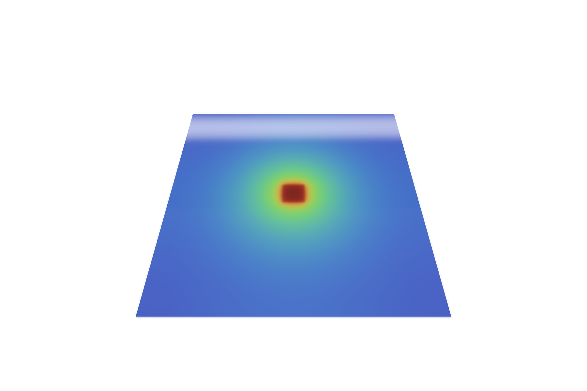 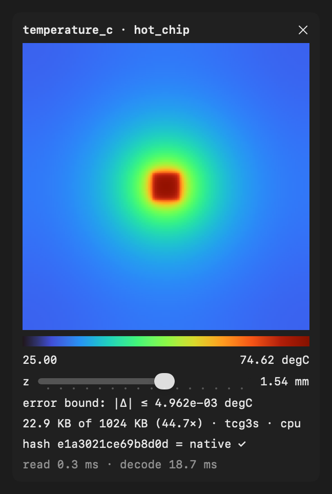

GPU decode (wgpu/Metal) is deliberately **not** wired. At this field size, CPU decode is already faster than WebGPU was in the browser (13 ms vs 55 ms warm), so it can wait until there's a large-field case that needs it. It must stay byte-identical when it is added.

## Multiphysics stack demo (bracket, coupled)

The bracket is one part with five co-registered fields from a **coupled
chain**, all compressed with the same contract and viewable in both apps:

```
busbar 200 A ──I²R──▶ thermal ──α(T−40 °C)──▶ stress  ◀── 60 N tip load
 (EM, 2D |B|)   0.266 W   (T field)            (von Mises, displacement)
```

| | |
|---|---|
| part | Aluminum motor-controller L-bracket (6061-T6): a 96×48×12 mm base plate plus a 9×48×36 mm wall flange. The geometry boxes live in `stack.json`. |
| grid | 128×64×48 cells at 0.75 mm. The thermal cells and the FE elements are the same grid, so ΔT maps one-to-one onto elements. |
| busbar → thermal | The plate carries 200 A DC. Joule heat is P = I²ρL/A = 0.266 W (ρ = 3.99e-8 Ω·m, L = 96 mm, A = 48×12 mm²). DC through a uniform section means uniform current density, so P goes in as a uniform volumetric source over the plate (`vcad-kernel-thermal --example bracket_field`). Effect: T_max goes from 44.55 to 44.67 °C. |
| thermal | A 6 W MOSFET heats the far end and the 40 °C wall cools the flange; every other face convects at h = 12 W/m²K. Range 39.98 → 44.67 °C. |
| thermal → stress | New additive API `analyze_fields_thermal(domain, spec, Some(&ThermalLoad))` in `vcad-kernel-topopt`. It applies the initial strain ε₀ = α·ΔT with α = 23e-6/K and computes σ = C(ε − ε₀). The equivalent nodal force is exact for a uniform ε₀ on a trilinear hex. Tests cover it: free expansion gives zero stress (< 1e-3 MPa) and δ = αΔTL to 2%; roller-ended bars read exactly EαΔT in every element; fully clamped ends read +3.5% at mid-span, which is real (the restrained ends stiffen the bar). `vcad-kernel-topopt --example bracket_field -- OUT --thermal T.f32`. |
| stress-free reference | **The wall temperature, 40 °C, not the 25 °C assembly temperature.** The chassis is the same alloy at 40 °C, so a bracket sitting uniformly at 40 °C grows with it and carries no stress; only T − 40 °C is mismatch. Using 25 °C against a rigid wall gave 99 MPa, which wrongly charges the bracket for expansion the chassis shares. The wall face is fully fixed, which over-restrains a real bolted joint, so near-wall stress is an upper bound. |
| stress result | Load + thermal peaks at **5.90 MPa** vs **5.49 MPa** for the load alone (+7%), both at the plate root. The coupled layer also shows thermal stress around the MOSFET footprint, which the load-only layer lacks (p99 is 3.5 MPa). Tip deflection goes from 30.4 to 31.0 µm. |
| busbar layer | Planar \|B\| on the plate's YZ cross-section, a **2D** layer (`"plane":"yz"`) placed at x = 48 mm. Peak 2.39 mT (hand calc µ₀I/2w gives 2.6). It treats the bar as infinitely long. |
| streams | TCG3-static at max-abs 1e-4 × range each: 20.6 + 35.6 + 32.8 + 13.2 + 3.1 KB = **105 KB for 6.3 MB raw (61×)**. |

**Viewers.**
- **Web:** `?fields=/fields/bracket`.
- **Native:** File ▸ Open Compressed Field… (pick the folder), or `VCAD_FIELDS=…/bracket`.
- **Surface mode** colors the part's exposed voxel faces by the active layer. The skin has 27k quads; the native app colors it by giving each quad a UV into a 256×1 colormap texture.
- **Slice mode** cuts along x, y or z and masks the void cells out.
- 2D layers sit on their own plane inside a ghosted part.
- The web app adds a hover probe that reads value ± bound at a point. There is no native probe yet.
- Color ranges are taken over solid cells only.

**Gate (2026-10-20, M4): PASS on every layer, every path.**

| layer | native Rust (`corpus`) | web WebGPU | web WASM-CPU | native app | measured \|Δ\| ≤ bound |
|---|---|---|---|---|---|
| thermal | `3048f6d56ae47311` | ✓ | ✓ | ✓ | ✓ (1e-4 × range) |
| stress (load + thermal) | `76cd14f4923fec65` | ✓ | ✓ | ✓ | ✓ |
| stress_mech (load only) | `7e7509c29c235505` | ✓ | ✓ | ✓ | ✓ |
| displacement | `2f50b000e9f9b475` | ✓ | ✓ | ✓ | ✓ |
| busbar (2D) | `2a433f8f79030415` | ✓ | ✓ | ✓ | ✓ |

`stress_mech` reproduces the pre-coupling stress layer **bit for bit** (same
hash as the uncoupled run). That's a free determinism check across separate
solver and encoder runs.

**Timings** (decode only):

| path | thermal / stress / stress_mech / displacement / busbar | whole stack |
|---|---|---|
| web WASM-CPU | 39 / 23 / 23 / 22 / 2 ms | 353 ms including the 6.3 MB uncompressed reference download for error checking |
| web WebGPU | 170 / 172 / 167 / 164 / 42 ms | 764 ms |
| native app (release Rust, debug Swift) | 17 / 18 / 18 / 17 / 1.3 ms | 251 ms (read + decode + solid mask + range) |

At 393k cells, WebGPU loses to CPU on fixed per-dispatch costs. So the web
decoder now **picks automatically**: CPU below 4M cells, GPU above. Pass
`&fieldgpu` or `&fieldcpu` to force one.

Web: 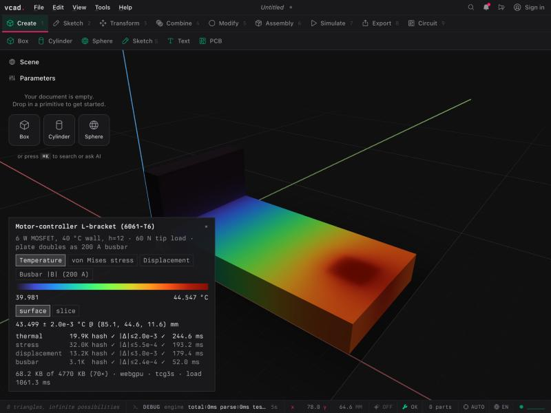 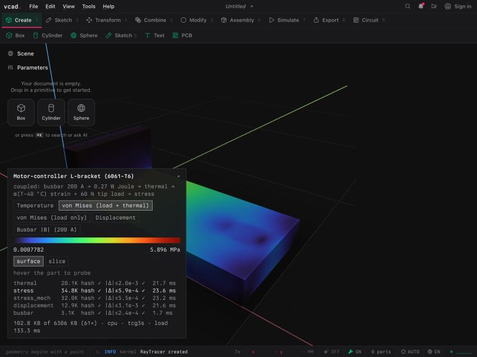
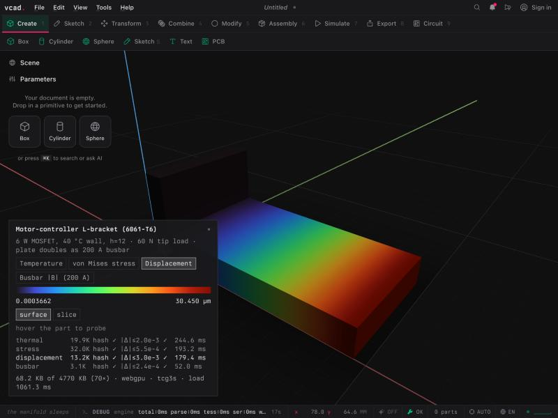 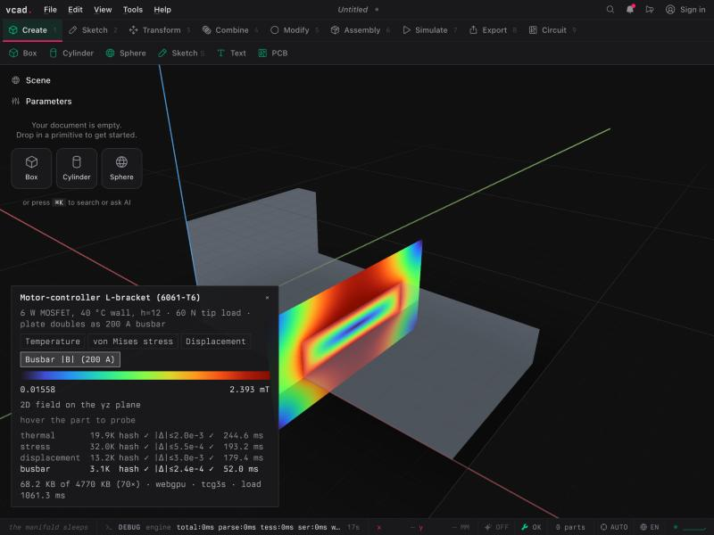
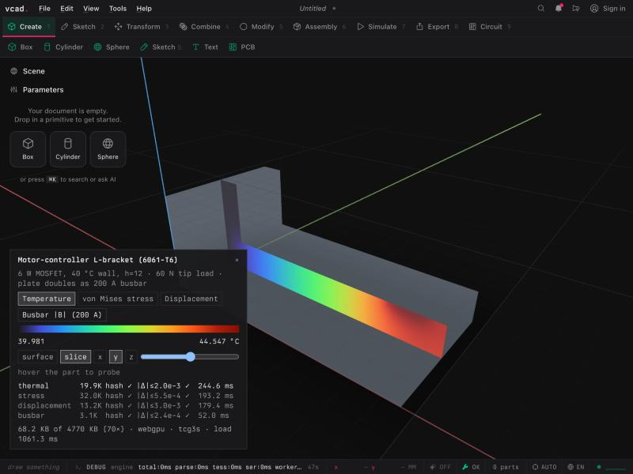

Native: 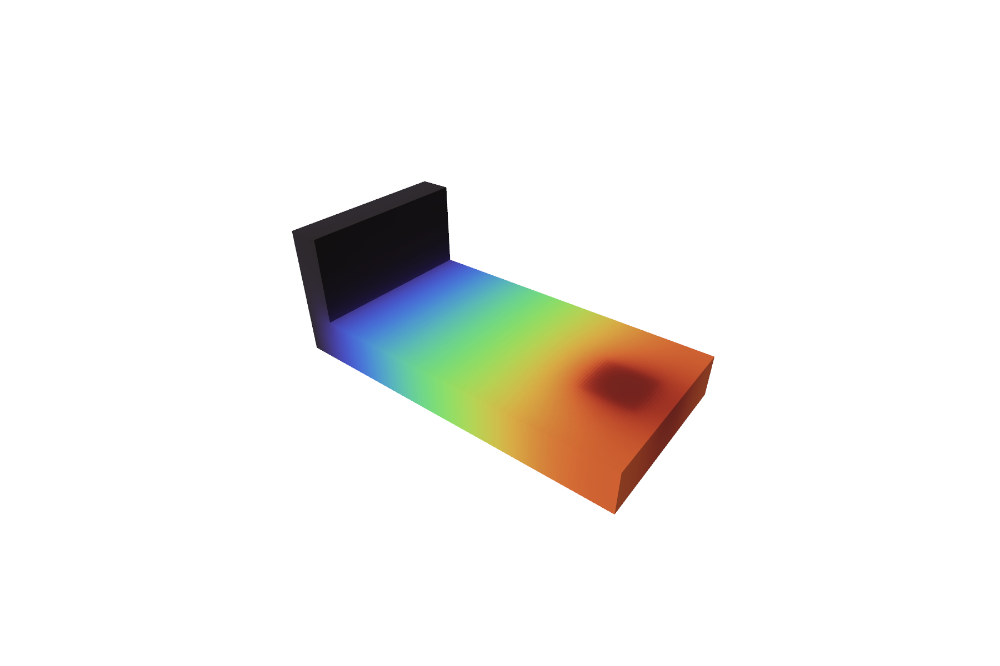 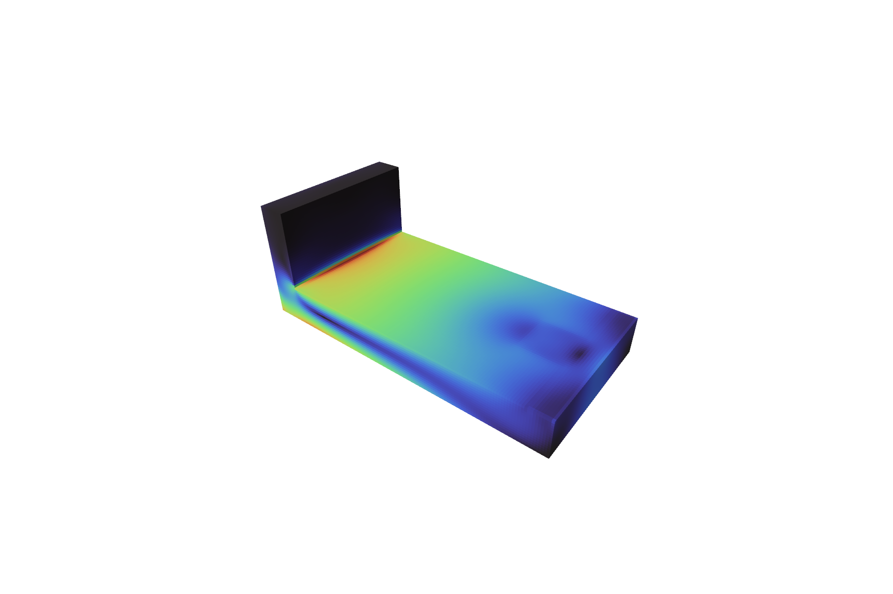
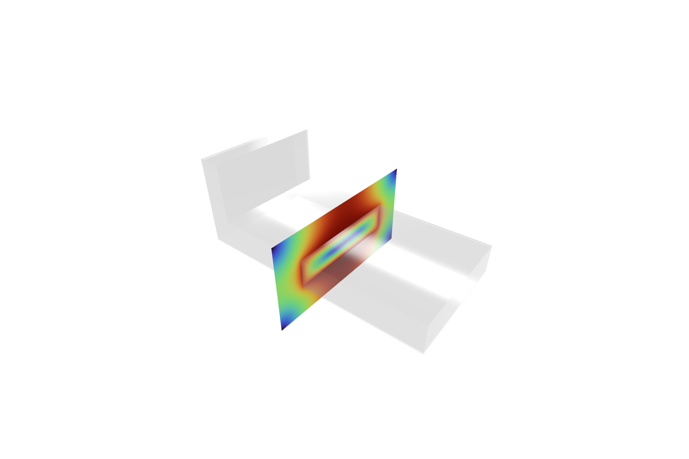 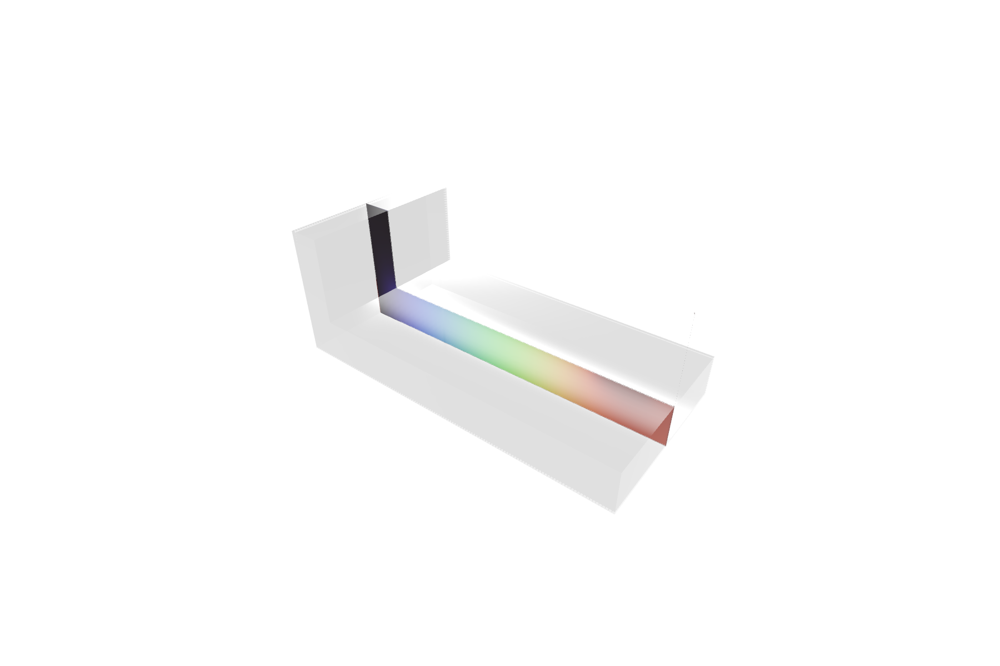 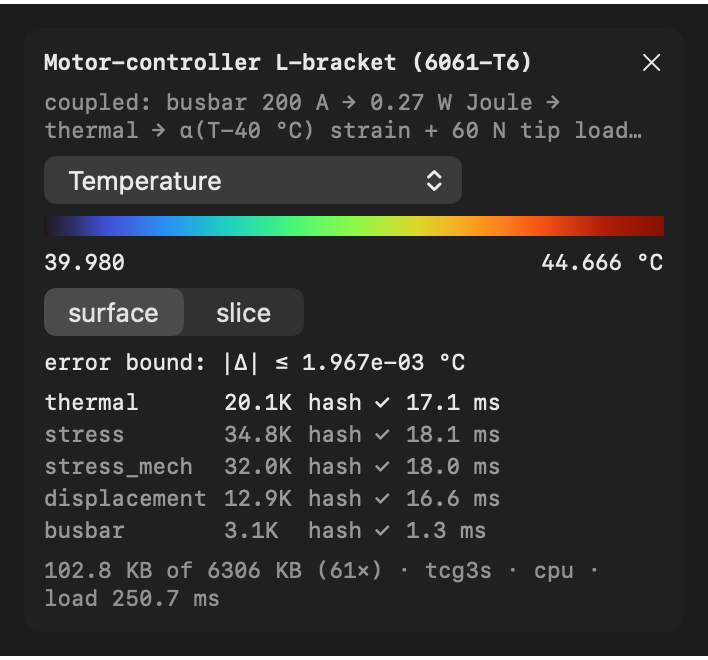

(`stack-web-stress.jpg`, `stack-native-stress.png` and the other uncoupled
captures are from the pre-coupling run.)

**Not modeled / next:**
- **The coupling is one-way.** T doesn't change resistivity, and deformation doesn't change the thermal or EM solves. At ΔT ≈ 5 K and 30 µm the feedback is negligible.
- **Joule heat is uniform over the plate.** There is no current crowding at the bolt and tip terminals; that needs a 3D current-flow solve.
- **The wall face is fully fixed.** A bolted-joint stiffness model would relax the near-wall stress.
- **No native hover probe.**
- **The geometry is boxes in `stack.json`,** not the document's BRep.
