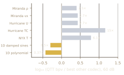
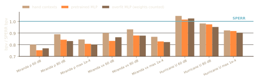
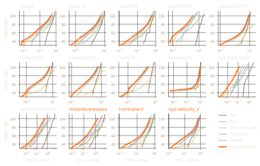
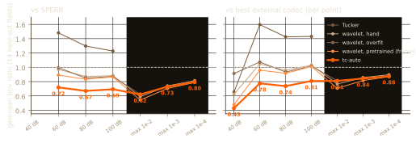
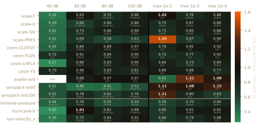
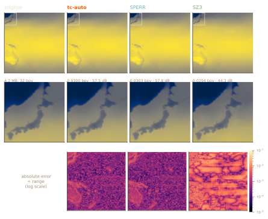
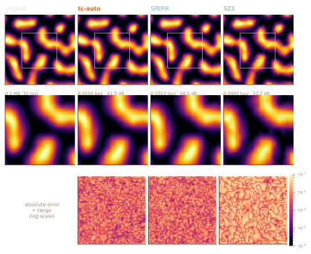
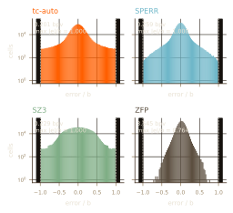
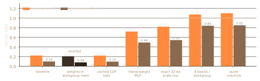

# tang-compress: error-bounded compression of scientific fields and ML tensors, with in-band prediction, learned integer context models, and a decoder that decodes the same bytes everywhere

*Preprint, revision 2 (2026-10-21; arXiv target 2026-10-29). Not peer-reviewed. Typeset version: `paper-draft.typ` / `paper-draft.pdf`; previous draft kept as `paper-draft-v1.*`. Nothing was re-measured for this revision: every number is copied from a source report, tagged in brackets in the text and mapped claim by claim in Appendix A.*

**Headline readouts.** 0.670× SPERR's bits at 80 dB (held-out 14) · 54/55 PSNR points won (held-out) · 53/62 fresh-set points within 5% of the best external codec · KV cache 24–28% fewer bits than the best baseline at Δppl ≤ 0.1 · learned GPU decode ≈1.1 GB/s (shared RTX 3090).

## Abstract

tang-compress is an error-bounded lossy compressor for floating-point data. Its main codec is a CDF 9/7 wavelet followed by per-band integer prediction, a deadzone quantizer, a context-modelled range coder whose probabilities come from hand-designed contexts or a small integer MLP, and a correction stream for pointwise bounds. A portfolio encoder tries this codec alongside Tucker, interpolation and tensor-train candidates and keeps the smallest stream. Every byte is counted and every error is measured on the decoder's output.

Tuned on five SDRBench fields and then frozen, the codec uses 0.67–0.72× SPERR's bits at matched PSNR on 14 held-out fields, and 0.74–0.81× the best external codec at each point, winning 54 of 55 PSNR points. A later portfolio version, frozen before it saw a second fresh set of nine fields from six new applications, stays within 5% of the best external codec at 53 of 62 points; all nine misses are traced to gaps in the candidate set.

All decoding arithmetic is integer, and decoded bytes are identical across CPU, Metal, Vulkan, browser WebGPU and WASM. A stream may carry its own verified decoder program, compiled from an integer IR. A GPU format decodes at about 1–2 GB/s on consumer GPUs at 4% more bits than the serial coder. A KV-cache codec built from the same parts uses 24–28% fewer bits than the best KV quantizer we tested at matched perplexity, but is too slow to decode inside the generation loop.

## 1. Introduction

Simulations and instruments now produce data faster than it can be stored, moved or read back. Lossless coders help a little, but on noisy floating-point mantissas they rarely get much past two to one. The field has therefore settled on *error-bounded* lossy compression. The scientist states how wrong a reconstructed value may be, either pointwise or as a root-mean-square target, and the compressor spends as few bits as it can while keeping that promise.

Four families of compressor define current practice, and each makes a different bet about where the redundancy in scientific data lives. Prediction coders such as SZ and its modular successor SZ3 [Di16; Liang22] bet on local smoothness: they predict each value from already-decoded neighbours, quantize the residual against the bound, and entropy-code what is left. Block-transform coders such as ZFP [Lindstrom14] bet on speed and random access: a fixed transform on 4^d blocks, coded bit plane by bit plane, decodes fast from any position but pays for its simplicity in rate. Wavelet coders such as SPERR [Li23] bet on multiscale structure: a CDF 9/7 transform concentrates energy, SPECK-style set partitioning [Pearlman04] codes where it went, and an outlier stream enforces a pointwise bound. Tensor coders such as TTHRESH [BallesterRipoll20] bet on low rank: an HOSVD core coded by bit planes is very strong on fields that factor along their axes, but offers no pointwise mode.

Our starting point is the wavelet family and a narrow question about it. Wavelet coders spend most of their engineering on the transform and on set partitioning, and comparatively little on the last step, which turns quantized coefficients into bits. SPECK codes significance and magnitude, but it does not use the fact that neighbouring coefficients inside one band are strongly correlated *[M1 §1]*. *How much rate is left in that last stage, and can a coder that recovers it stay deterministic enough to decode bit for bit on a GPU?* The second half matters because data are only useful if they can be read back quickly, and the fastest hardware most scientists have is a GPU whose floating-point behaviour differs from that of the CPU that encoded the data.

The answer to the first half is that a good deal of rate is left. Per-band integer prediction and a richer context model, hand-designed or learned, let the wavelet coder use about a third fewer bits than SPERR at matched quality on fields it was never tuned on. The answer to the second half is yes, at a cost that we have since reduced. An integer-only decoder produces identical bytes on every CPU and GPU backend we tested, decodes at one to two gigabytes per second, and now gives up about 4% of rate against the serial coder.

Two things grew out of the same machinery and are reported here as well. Because the decoder is integer-only, it can be written as a program in a small verified integer IR, and a stream can carry that program with it, so that a receiver needs no built-in knowledge of the coder. And because the same parts (prediction, a context model, an exact integer coder) are not specific to scientific fields, we built a codec for transformer KV caches from them and compared it with the KV quantizers in current use.

We make five contributions:

1. A compressor in which every stage, from transform to range coder, is bit-accounted, with a max-abs mode and a portfolio encoder that picks among wavelet, Tucker, interpolation and tensor-train candidates (§3).
1. An evaluation protocol with two freezes. The codec was frozen after tuning on five fields and measured on fourteen unseen ones; a revised portfolio was frozen again before a second fresh set of nine fields from six further applications (§4–5).
1. A decoder whose output is byte-identical across CPU, Metal, Vulkan, browser WebGPU and WASM, and a container (TCS1) in which the stream ships its own decoder as verified integer graphs (§6).
1. GPU stream formats with parallel code-blocks and a learned context model compiled into the shader, at 4% rate cost over the serial coder (§7).
1. A KV-cache codec for storage, offload and transfer, compared against KIVI, KVQuant-, QuaRot- and TurboQuant-style baselines on models from 135M to 7B parameters (§8).

Section 9 is an account of where the method loses and what we did not measure, which we think is as useful as where it wins.

## 2. Notation and measurement

We use one set of definitions for every codec, and we measure every codec on its decoded output rather than trusting its own report. *Rate* is bits per value (bpv): the full size of the compressed file in bits divided by the number of values, so headers, side information, shipped weights and shipped decoder programs are all included. *PSNR* is $20 log_(10)("range" / "RMSE")$, where range is max − min of the original field. A *max-abs* bound is $b = "rel" dot "range"$ with rel ∈ {1e-2, 1e-3, 1e-4}, and a run counts only if every reconstructed cell lies within b of the original. *[M0 §2]*

Codecs expose different knobs, so we never compare them knob for knob. Each codec is swept over its own settings, its measured (PSNR, bpv) points form a Pareto front, and the rate at a target PSNR is a log-linear interpolation on that front. Across fields we report the geometric mean of bpv ratios, codec over reference, over the fields where both are defined; 0.7 means 30% fewer bits. "Best external" means the smallest of SPERR, TTHRESH, SZ3, ZFP and our own QTT codec at that individual point, chosen with hindsight. *[M1 §8; S]*

## 3. Method

The main codec is a pipeline of five stages (Figure (pipe)). A field is transformed by a wavelet, each band is predicted from itself, the residuals are quantized, a context model gives every binary decision a probability, and a range coder turns those probabilities into bits. A correction stream enforces pointwise bounds, and an encoder-side portfolio tries other codecs and keeps the smallest stream. Every byte from every stage passes through one bit-accounting writer. *[M1 §1]*

*Figure (pipe): pipeline diagram (typst only).* The pipeline. Every byte from every stage passes through one bit-accounting writer, so the reported rate has no side channel. *[M1 §1; M1d §1, §9; P]*

### 3.1 Transform
We use the CDF 9/7 biorthogonal wavelet [Cohen92], implemented by lifting [Sweldens96] in IEEE double precision with whole-sample symmetric extension, so any length works, odd ones included. An integer LeGall 5/3 transform gives a lossless mode through the same coder. The pyramid is allowed to become anisotropic: at each level every axis still at least eight samples long is split, so a 64×128×128 crop gets four levels on its short axis and five on the others. Coefficients are scaled by the norm of their band's synthesis basis, so one quantizer step gives the same mean-squared error in every band. *[M1 §1]*

### 3.2 Per-band integer prediction
The idea that matters most in this paper is also the simplest. After a wavelet transform, a highpass band of a smooth field is not noise. Along the axes on which it was lowpass filtered it is itself smooth, with neighbour correlations around 0.9, and along its highpass axis neighbours are anti-correlated, at around −0.5 *[M1 §1]*. A coder that codes each coefficient's magnitude from scratch throws that away.

We fit a small causal predictor to each band: seven taps (west, north, up, the three diagonals between them, and the parent one level coarser) with least-squares weights stored as Q12 integers. The weights are fitted on the *quantized* values the decoder will see, so encoder and decoder predict identically, and a band keeps its predictor only if a cost proxy drops by more than 2%. The coder codes the residual $q - "pred"$, and all contexts are computed on residuals. On Hurricane-U at 80 dB this step alone moved the rate from 1.94 to 1.69 bpv, a 13% saving and the largest single gain in development. *[M1 §1]*

### 3.3 Quantization, contexts and coding
Coefficients are quantized with a deadzone, $q = "sgn"(c) floor(|c| / Delta + 0.45)$, and reconstructed at a transmitted centroid for each combination of band class and |q| ∈ {1, 2, ≥3}: thirty offsets at 1/512 resolution. For PSNR or RMSE targets the step Δ is found by bisection on the RMSE of the actual decoder output. *[M1 §1]*

The coder is an integer, carry-propagating 32-bit binary range coder of the kind used in LZMA, with 16-bit probabilities and two-rate adaptive bit models. Each residual is split into binary decisions: zero or not, a short unary code on $(|r| - 1) >> k$ with an adaptive Golomb parameter k, a few nearly raw low bits, and a sign. The contexts are the subband class, the activity of eight causal neighbours in the band, the parent and its six face neighbours, and the signs of the west, north and up neighbours. *[M1 §1]*

### 3.4 A learned integer context model
A hand-designed context model conditions only on what its designer thought of. As an alternative we train a small MLP to predict each residual's distribution from 37 integer features: log-magnitudes of seventeen causal or coarser coefficients, the band's prediction, activity summaries, and a one-hot band class. Weights are 8-bit fixed point with 64-bit accumulators, and the output is a two-component discretized logistic mixture, the output family of PixelCNN++ [Salimans17]. *[M1 §3]*

The difficulty is not training the network but making its output reproducible. Every binary probability is an integer ratio of cumulative masses read from Q24 and Q16 tables built only from the correctly rounded IEEE operations + − × / √, so no maths library is involved. The model comes in two modes. A *pretrained* network (37→64→32→5, 4,677 parameters) is named in the stream by an eight-byte fingerprint. An *overfit* network (37→16→5, 693 parameters) is trained on the field at encode time and its weights, about 750 bytes, are coded into the stream and counted. *[M1 §3]*

### 3.5 Pointwise bounds
For a pointwise bound b, the wavelet layer is coded at Δ = f·b for eight values of f in [1, 5] and decoded. Every cell whose error still exceeds b gets an integer correction $k = "round"((x - hat(x)) / 2b)$, which guarantees $|x - hat(x) - 2 b k| <= b$. Corrections are coded as a context-coded significance map plus magnitudes, and the encoder keeps the f with the smallest total stream, re-verifying the bound on the decoder's output. This is SPERR's outlier idea [Li23] with a context-coded map. *[M1 §1]*

### 3.6 Other candidates and the portfolio
Some fields are better described as low-rank tensors than as multiscale images. A Tucker codec in the style of TTHRESH [BallesterRipoll20; DeLathauwer00] computes an HOSVD from the mode Gram matrices, truncates ranks by rate–distortion, quantizes factors with per-column DPCM, refits the core against the quantized factors, and codes it with the wavelet coefficient coder. Tucker has no max-abs mode. *[M1 §1]*

The first shipped encoder, *tc-auto*, encoded with wavelet and Tucker and kept the smaller stream behind a one-byte tag *[M1 §8]*. Its held-out losses (§5) pointed to two missing candidates, and the *portfolio* encoder adds them. The first is an SZ3-style multilevel interpolation codec (*interp*) with per-level linear or cubic prediction, level-wise bounds, error checks on the exact f32 reconstruction, and context-coded residuals; it costs a median 0.13 s per million values *[P §1]*. The second is our QTT codec [Oseledets11], which is expensive (up to 58 s per encode), so it runs only when a cheap screen predicts it can win. The first screen, a peakiness statistic, missed one case *[P §1]*. Its replacement runs QTT on a 2×-decimated copy with ranks capped at 64 (mean 0.12 s) and runs full QTT only when the probe's rank stays below the cap; a separate *qtt-sparse* candidate, the residual-only QTT stream that had produced every EXAFEL win, always runs at max-abs targets and costs 0.02–0.1 s *[P §2]*. On the 19 seen fields this screened portfolio matched an all-candidate oracle at all 209 points (worst 1.000003×) while spending 45 s on full QTT instead of 1,443 s *[P §2]*.

A *fast* mode chooses one candidate by trial-encoding a centred eighth of the field, sets Δ from a formula refined by a few secant steps on a coefficient-domain error estimate, and uses the static context model *[P §2]*.

## 4. Experimental protocol

The central risk in a paper like this one is that the codec has been tuned, deliberately or not, to the fields it is evaluated on. We addressed that with two freezes and three disjoint sets of fields.

*Development set.* All development used five fields, Miranda density and x-velocity, Hurricane Isabel U and TC, and NYX temperature, cropped to interior 64×128×128 windows, plus four synthetic 1D signals *[M0 §2]*.

*Held-out set (14 fields).* When development was finished we froze the codec at commit `4e27445` and a pretrained model trained only on the development fields. Only then did we fetch the fourteen fields of Table (sets). Eleven come from four applications that played no part in development; three come from the development simulations and act as controls. One encoder-only crash fix landed during the run, after which the development Tucker streams were re-verified byte-identical. *[M1 §8]* The first portfolio was frozen at `6b00aff` before it was run on this set *[P §1]*.

*Fresh set (9 fields).* The portfolio's revised screen was tuned on all 19 fields seen so far, which made the held-out set no longer unseen for that decision. The code was frozen again at `838bc22`, and only then were nine fields from six further SDRBench applications fetched *[P §2]*.

| Application | Fields | Crop |
|---|---|---|
| **Held-out · new applications · 11** | | |
| SCALE-LETKF | T, U, QV, PRES | 64×128×128 |
| CESM-ATM | CLDTOT, FLDS, LHFLX, TS | 1024² 2D |
| EXAFEL | event 0 | 1024² 2D |
| QMCPACK | orb 0, orb 100 | 115×69×69 |
| **Held-out · same applications · 3** | | |
| Miranda · Hurricane · NYX | pressure · V · velocity_x | 64×128×128 |
| **Fresh · six new applications · 9** | | |
| S3D | O2, T, U | 64×128×128 |
| Basilisk | u, v | 1024² 2D |
| XGC | dpot | 2048×512 |
| EXAALT | Cu x | 1024² 2D |
| HACC · NWChem | vx · 631-tst | 2²⁰ 1D |

*Table (sets).* Evaluation sets, each fetched only after the relevant freeze. *[M1 §8; P §2]*

*Baselines.* SPERR in PSNR and pointwise modes; TTHRESH in PSNR mode only, and only on inputs of three or more dimensions; SZ3 in PSNR and absolute-bound modes; ZFP, given for max-abs the largest tolerance whose actual maximum error stays within b; and our QTT codec *[M0 §2, §8]*. The tools' own error reports were ignored: every file was decoded by its own decoder, measured by one harness, and checked cell by cell for max-abs. *[M0 §8.2; M1]*

*Timing.* Every timing in this paper was taken on a machine shared with other work: an Apple M4 Max at load averages of 5–70, and later a shared RTX 3090 whose GPU was at full utilisation from other tenants during most runs. Repeats varied by up to a factor of two. Rates are exact; timings should be read as orders of magnitude, and we report medians or best-of-N as the source does. *[M1; M1d; C]*

## 5. Results on scientific fields

### 5.1 A detour that set the direction
Before the wavelet coder we built a bit-accounted QTT codec [Oseledets11], because tensor trains promise logarithmic storage for fields with the right structure. On real 3D fields at 60 dB and above it lost everywhere: two to three times the bits of SPERR or TTHRESH on Miranda and Hurricane and six times or more on NYX. It won only on 1D oscillatory and algebraic signals, by two to six times on damped sinusoids (Figure (qtt)). That pointed us to a strong transform with a strong entropy coder, and QTT survives as a portfolio candidate for the few fields where it wins. *[M0 §8.3–8.5]*

*Figure (qtt).* QTT bpv relative to the best other codec at 60 dB on the development set. Bars right of zero are losses. *[M0 §8.3]*

### 5.2 The development fields
Table (dev) shows the classical stack against the external codecs on the development fields. tc-wavelet is ahead of SPERR at every point but one (Hurricane U at 60 dB, +4.7%), and Tucker is ahead of TTHRESH at 100 dB on Miranda by 11% (density) and 15% (x-velocity). Tucker is not universal: on NYX temperature, which is not low-rank, tc-wavelet beats SPERR (0.445 / 2.75 / 6.09 against 0.575 / 3.13 / 6.50 bpv at 60/80/100 dB) while Tucker falls well behind (1.18 / 4.40 / 7.95). *[M1 §2]*

| Field | Target | SPERR | TTHRESH | SZ3 | tc-wavelet | tc-tucker |
|---|---|---|---|---|---|---|
| Miranda density | 60 dB | 0.307 | 0.314 | 0.580 | 0.246 | **0.218** |
|  | 80 dB | 1.196 | 0.773 | 2.58 | 1.064 | **0.620** |
|  | 100 dB | 2.843 | 1.590 | 5.56 | 2.504 | **1.413** |
|  | max 1e-4 | 2.005 | n/a | 3.40 | **1.694** | n/a |
| Miranda velocityx | 60 dB | 0.191 | 0.222 | 0.352 | 0.172 | **0.144** |
|  | 80 dB | 0.876 | 0.618 | 1.98 | 0.816 | **0.493** |
|  | 100 dB | 2.347 | 1.534 | 4.87 | 2.163 | **1.299** |
|  | max 1e-4 | 1.617 | n/a | 2.60 | **1.403** | n/a |
| Hurricane U | 60 dB | 0.323 | 0.397 | 0.809 | 0.338 | **0.284** |
|  | 80 dB | 1.711 | 1.421 | 3.67 | 1.680 | **1.167** |
|  | max 1e-4 | 2.810 | n/a | 4.45 | **2.592** | n/a |

*Table (dev).* Classical stack on the development set, bpv (lower is better; best in orange). *[M1 §2; S]*

The learned context model adds a smaller step (Figure (dev)). With transform and predictor fixed, it saves 3–7% over the hand contexts; at 80 dB the overfit network saves 6.6% on Miranda density, 5.8% on x-velocity and 3.0% on Hurricane U. These development-set models were trained with field-family exclusion, so no Miranda data was used for the Miranda tests. *[M1 §3]*

*Figure (dev).* The learned context model on the development set, bpv relative to SPERR: hand contexts, a pretrained MLP, and an overfit MLP whose weights are counted in the rate. *[M1 §3]*

### 5.3 Held-out fields: the headline result
The held-out fields are the main test, because nothing in the frozen codec was chosen with them in view. Figure (rd) shows each codec's measured rate–distortion front on every field. On almost every panel the tc-auto curve sits to the left, and the margin is as large on the new applications as on the controls.

*Figure (rd).* Rate–distortion fronts on all 14 held-out fields: measured PSNR against bpv, log x axis. Orange titles are same-application controls. TTHRESH is absent on the 2D fields. *[B heldout_*.csv]*

Across fields, the frozen tc-auto uses 0.719, 0.670 and 0.693 of SPERR's bits at 60, 80 and 100 dB (Figure (agg)). Against the per-point best external codec it uses 0.775, 0.737 and 0.808. The frozen pretrained learned model transfers too: alone it reaches 0.83–0.89 of SPERR, where the hand contexts reach 0.87–0.97. Splitting by group shows no penalty for new applications (0.741 against the best external codec at 80 dB on the eleven new-application fields, 0.722 on the three controls), and counting points, tc-auto beats the per-point best external codec on 54 of 55 PSNR points and 34 of 42 max-abs points, with ±1% counted as a tie. *[M1 §8; S]*

*Figure (agg).* Geometric-mean bpv ratio over the 14 held-out fields. In the shaded max-abs band tc-auto equals the overfit wavelet, because Tucker has no max-abs mode. *[M1 §8; S]*

The losses are informative, and Figure (heat) shows them. All but one are max-abs points, of two kinds. On very smooth fields at the loosest bound (QMCPACK, scale-PRES and scale-T at 1e-2) the stream is only 0.01–0.06 bpv, our fixed overheads become a large share of it, and SZ3 or QTT wins by 1.02–1.49×. On sparse, peaky data at tight bounds (EXAFEL, QMCPACK orbital 0) the wavelet smears each peak, the outlier stream grows, and QTT wins by 1.08–1.31×. The single PSNR loss is Hurricane-V at 60 dB, by 1.4% to SPERR. *[M1 §8; S; P §1 table]* (One point was attributed to SZ3 in M1 §8 and to QTT in S; the per-point table in P §1 confirms QTT, at 0.02405 bpv.)

*Figure (heat).* tc-auto bpv over the best external codec at each held-out field and point, with that codec named underneath. Green means fewer bits. *[S, held-out per-field table]*

The first portfolio was built to remove exactly those losses, and it was frozen before it ran on this set. Interp took all four loose-bound losses (for example scale-PRES at 1e-2 from 1.489× to 0.749×) and QTT took both EXAFEL points to parity, moving the max-abs record from 34–8 to 38–1–3 and the max-abs geometric means from 0.810 / 0.843 / 0.876 to 0.677 / 0.811 / 0.871 at 1e-2 / 1e-3 / 1e-4. PSNR results were unchanged at 54–1. The one remaining miss, QMCPACK orbital 0 at 1e-4 (1.150× QTT), was a screen failure: that field is smooth and low-rank rather than peaky, so the peakiness screen skipped QTT, which would have won. That miss is what the rank probe of §3.6 fixes, but the fix was tuned with this set in view, which is why a second fresh set was needed. *[P §1]*

### 5.4 Fresh set: an honest re-gate
On the nine fresh fields, the frozen portfolio's geometric mean against the per-point best external codec is 0.881 / 0.718 / 0.778 at 60 / 80 / 100 dB and 0.769 / 0.936 / 0.883 at max-abs 1e-2 / 1e-3 / 1e-4 (Table (fresh)). It is within 5% of the best external codec at 53 of 62 points, so the pre-registered gate, no point more than 5% worse, failed at nine. Points won and lost are 28–7 at PSNR and 21–3–3 at max-abs. *[P §2]*

| Point | held-out 14, tc-auto | held-out 14, portfolio | fresh 9, portfolio |
|---|---|---|---|
| 60 dB | 0.775 | 0.775 | 0.881 |
| 80 dB | 0.737 | 0.737 | 0.718 |
| 100 dB | 0.808 | 0.808 | 0.778 |
| max 1e-2 | 0.810 | 0.677 | 0.769 |
| max 1e-3 | 0.843 | 0.811 | 0.936 |
| max 1e-4 | 0.876 | 0.871 | 0.883 |

*Table (fresh).* Geometric-mean bpv over the per-point best external codec. *[M1 §8; P §1, §2]*

The misses are worth reading closely, because none is a screening error: for no failing point did the screen skip a candidate that would have won *[P §2]*. Five are on EXAALT copper coordinates, particle data with little spatial smoothness, where SZ3 beats every tang candidate by 1.06–1.42×; our interp is 1.25× larger than SZ3 there at 1e-2, so this is a quality gap in our interpolation codec, not a choice error. Two are high-rate PSNR points (HACC vx and XGC dpot at 100 dB, 1.22× and 1.09×) where interp was not yet a PSNR candidate. Two are Basilisk u and v at 60 dB (1.33× and 1.34×), where SPERR's front is nearly flat between 50 and 70 dB; we have not diagnosed why. *[P §2]*

Interp has since been made a candidate at PSNR targets. As a diagnostic, not a gate, it would take HACC at 100 dB to 0.97× SZ3 and XGC at 100 dB to 1.02× SPERR; on the 19 seen fields it wins 5 of 146 PSNR points, all at 30–50 dB *[C §(c); P Phase 3 note]*. Because those fresh-set numbers were looked at, they cannot count as a test, and a third set is being run (§5.5).

Fast mode passed its own gate on the fresh set: 23.7× faster encoding than the full portfolio (minimum 10.0×) for 1.013× the bits (maximum 1.61×, on EXAALT), with median encodes of 0.086 s at max-abs and 0.117 s at PSNR against 2.8 s and 2.2 s *[P §2]*.

### 5.5 Pending gates

> **Placeholder · Third fresh set (gate 16).** To be filled when gate 16 finishes (due Wed Oct 28). This set re-gates the current portfolio, frozen before the set is fetched. SDRBench's mirror has no unused applications left, so it uses *unseen fields from applications already seen*, a weaker test than §5.4 (see §9). No numbers below exist yet. *[RK, Gates]*
>
> | Set | 60 dB | 80 dB | 100 dB | 1e-2 | 1e-3 | 1e-4 |
> |---|---|---|---|---|---|---|
> | third set, portfolio | TBD | TBD | TBD | TBD | TBD | TBD |
> | points within 5% | TBD of TBD |

> **Placeholder · Images vs Cool-chic (gate 17).** To be filled when gate 17 finishes (Kodak, evaluation running). If the gate fails by Oct 28, this subsection is removed rather than reported in part. No numbers below exist yet. *[RK, Gates]*
>
> | Codec | bpp @ PSNR TBD | BD-rate vs Cool-chic | decode time |
> |---|---|---|---|
> | tang-compress | TBD | TBD | TBD |
> | Cool-chic [Ladune23] | TBD | 0 (ref.) | TBD |

### 5.6 What the numbers look like
Ratios are abstract, so we also looked at reconstructions; these were new runs made for the first draft and logged in `demo_results.json`. At about 0.03 bpv on held-out CESM surface temperature (Figure (cesm)), tc-auto and SPERR are at parity, 57.5 and 57.8 dB with SPERR using 1% more bits, while SZ3 reaches 44.3 dB. We show it because it is typical of the 2D CESM fields, where the advantage over SPERR is modest. On a Miranda density slice at about 0.05 bpv (Figure (miranda)) the gap is larger: 41.3 dB against SPERR's 40.5 and SZ3's 33.2. With a pointwise bound of a thousandth of the range on CESM-TS (Figure (bound)), every codec keeps all 1,048,576 cells inside ±b; tc-auto needs 0.201 bpv, SZ3 0.229, SPERR 0.259 and ZFP 3.55. *[demo]*

*Figure (cesm).* Equal rate on a held-out field: CESM-ATM surface temperature at about 0.03 bpv. Rows: full field, boxed region at full resolution, absolute error ÷ range on a shared log scale. ZFP's smallest stream is 1.31 bpv, so it is left out. *[demo]*

*Figure (miranda).* Equal rate on a development field: Miranda density, slice z = 32, at about 0.05 bpv. ZFP's smallest stream is 0.32 bpv. *[demo]*

*Figure (bound).* Pointwise bound b = 10^−3 · range on CESM-TS: signed error ÷ b over all cells, log count. Every codec stays inside the dashed lines. *[demo]*

## 6. One decode, every backend

### 6.1 Integer decoding
The wavelet decoder used for the CPU results is deterministic across CPUs because it uses plain double-precision lifting with no fused operations *[M1 §1]*. A GPU, a browser, or a different instruction set gives no such promise. The GPU formats therefore decode entirely in integers. Values live on a fixed-point grid $x approx v dot 2^e$; dequantization uses a 30-bit mantissa per band; the inverse wavelet uses Q24 lifting constants through an exact 32×32→64-bit multiply, emulated with 16-bit limbs where WGSL has no 64-bit integers; and the final conversion to f32 is exact because $|v| < 2^24$ and the scale is a normal power of two. The encoder rate-controls on this integer decoder, so the fixed-point loss is inside every rate we report. *[M1d §1]*

The learned model obeys the same discipline: the MLP runs in 32-bit integers under clamps on weights (±2047), activations ([0, 2^14]), outputs and biases chosen so that no partial sum can overflow, and its probabilities are integer ratios of Q16 CDF masses *[M1d §10]*. Given the same stream, every correct implementation must then produce the same bits; the question is whether ours do.

### 6.2 Byte identity across backends
Table (exact) collects every identity check we ran. On an Apple M4 Max through Metal, every sweep of 19 fields × 5 targets was byte-identical between CPU and GPU, for every format and lane count, and every random-access sub-box matched the corresponding crop of a full decode *[M1d §2, §9–13]*. On an RTX 3090 through Vulkan, the GPU test suite and every NYX 512³ timing decode matched the CPU *[C §(a), §(b)]*. In headless Chrome, 285 of 285 decodes were identical, covering 19 fields × 5 targets × three formats, each decoded on WebGPU and on the WASM CPU path and hashed against the native CPU decode *[W]*. Two later browser runs covered streams with the adaptive probability layer (50/50) and shipped decoders (25/25, ten of them TCS1) *[C §(b); SD]*.

| Check | Backend | Identical |
|---|---|---|
| TCG1, 2 brick sizes | Metal | 190/190 |
| TCG3 static, 1 lane, 2 block sizes | Metal | 190/190 |
| TCG3 static, 8 lanes | Metal | 95/95 |
| TCG3 learned, after speedups | Metal | 95/95 |
| TCG3 learned v4 layout | Metal | 95/95 |
| GPU tests + NYX 512³ streams | Vulkan | all |
| 3 formats, 19 fields × 5 targets | WebGPU + WASM | 285/285 |
| adaptive (APM) streams | WebGPU + WASM | 50/50 |
| 25 streams incl. 10 TCS1 | WebGPU + WASM | 25/25 |

*Table (exact).* Byte-identity checks against the native CPU decode. *[M1d §2, §9–12; C; W; SD]*

Two caveats belong next to this table. The latest kernel change, an occupancy fix (§7.3), changes no bitstream or output by construction, but it was verified on Vulkan only; the browser gate was not re-run after it and Metal was not re-timed *[C, learned-path section; RK]*. And the identity claims cover the wavelet formats; the CPU Tucker reconstruction can differ in the last place across instruction sets *[M1 §1]*.

The browser path also found a real bug. The adaptive layer's 17 KB workgroup array exceeded WebGPU's 16 KB default, so every TCG3 stream with that layer had decoded to garbage in the browser; the decoder now requests the adapter's limit and fails cleanly when it is too small *[C §(b)]*. We mention it because a byte-identity gate run in the browser is what caught it.

### 6.3 The decoder ships in the stream (TCS1)
Once the coding path is a pure integer function, it can be expressed as data. We added an integer dialect to tang-expr, the expression IR of the numerical stack the codec is built on. Its graphs have `i32`, `u32` and `bool` values, wrapping arithmetic with fixed shift semantics, an exact widening multiply, structured loops with explicit trip caps, read-only buffers, and small scratch buffers written through effects that every backend executes in one shared order. Nothing is reassociated or contracted, and the CPU interpreter, the generated WGSL and the generated Rust are required to compute the same bits *[IR mod.rs]*. The TCG3 rANS lane decoders, static and learned, and optionally the learned MLP with its weights as constants, are written as such graphs *[irdec.rs; SD]*.

These graphs are now the built-in decoder: the WGSL kernel's residual-decoding region is generated from them. They are also a wire format. A *TCS1* container is the magic `TCS1`, a length, a decoder program (one `TIR1` graph per role), and an ordinary TCG3 stream. A receiver verifies the program, lowers it to WGSL with bounds-checked loads and to the CPU interpreter, caches it by content hash, and decodes. A stream that ships its MLP needs no model registry. *[SD]*

Shipping code inside data needs a threat model, and ours assumes the attacker controls the whole stream. The verifier rebuilds each graph node by node and rejects anything the trusted builder could not have produced: operands that are not earlier nodes, type or scope errors, malformed loops, ABI mismatches for the role, and anything over resource limits of 2^14 nodes per residual graph, loop trip caps of 64, nesting depth 2, worst-case work of 2^16 node evaluations per residual and 1 MiB per program. The op set has no float, store outside scratch, atomic, barrier, call or I/O; loads out of range read 0 on both backends; and every identifier in the generated WGSL comes from the host. A verified graph is therefore a total, terminating, deterministic function of its inputs. What remains is a slow-decode risk of up to about 2^16× per coefficient, which a host should bound with its own time budget, and a cache key that is a 64-bit FNV hash, which BLAKE3 would harden. *[SD, threat model; IR wire.rs]*

The cost is small (Table (tcs)). On NYX 512³ at 80 dB, a shipped program adds 0.41% to a static stream and 1.09–2.27% to learned streams that ship their MLP. Verification and lowering take 0.45–1.68 ms, and the cold GPU pipeline 0.16–0.69 s, dominated by compiling the whole kernel module; a cache hit is microseconds. Shipped decoders run at the speed of the built-in ones, and the IR-generated decoder is within 2% of the hand-written kernel on static streams and 3–8% faster on learned ones, because the predicated form removes early-return divergence. *[SD, results]*

| Stream | Program | Verify+lower | GPU GB/s |
|---|---|---|---|
| static | 0.41% | 0.45 ms | 1.73–1.77 |
| 16-hidden + MLP | 1.09% | 0.92 ms | 1.08–1.10 |
| 32×16 + MLP | 2.27% | 1.68 ms | 0.83–0.85 |

*Table (tcs).* TCS1 overhead on NYX 512³ at 80 dB (M4, shipped-decoder throughput, two rounds). *[SD]*

## 7. GPU code-blocks

### 7.1 Format
The serial coder decodes one coefficient after another, because every context depends on what came before. A GPU needs thousands of independent pieces of work. Our first GPU format, TCG1, split the field into independent bricks, each with its own pyramid; it decoded at 1.3–7.3 GB/s in kernel time but cost 15–48% in rate against the serial coder, depending on brick size *[M1d headline, §3]*. Its successor, *TCG3*, keeps one global fixed-point pyramid and tiles each subband into code-blocks of 32³ (128² in 2D), in the spirit of JPEG 2000's EBCOT [Taubman00]. A block may read any coarser coefficient but only its own region at its own level, so all blocks of a level are independent. Inside a block, lines are dealt to 8 interleaved rANS lanes [Duda13] in hierarchical parity passes. Probabilities come from static priors sent in the header, or from the learned MLP compiled into the shader with the stream's weights as literals. *[M1d §9–11]*

### 7.2 Closing the rate gap
The first learned TCG3 coder cost 12–13% more bits than the serial coder at 80 dB *[M1d §10]*. Two rounds of work brought that to 4%. The first found where the bits went: about 4.5 bytes of rANS framing per non-empty lane, half of it in tiny coarse-level blocks that still used eight lanes, and a predictor whose tap sums mixed lines across rows. Fewer lanes for small blocks, predictor taps grouped by axis, a compact header and a retrained network gave 1.076× *[M1d §12]*. The second added a small adaptive probability map per lane on top of the MLP: 8 decision contexts × 17 bins, interpolated in the logistic domain, updated with a count-based rate that needs no division, reset at every block, and integer throughout. That gave 1.043× on all 19 fields and 1.065× on the 14 held-out fields *[M1d §13]*.

| 80 dB, geomean vs serial | all 19 | held-out 14 |
|---|---|---|
| TCG3 static, 8 lanes | 1.182 | — |
| learned, first layout (16) | 1.134 | 1.164 |
| + compact lanes, axis taps, v4 net | 1.076 | 1.104 |
| + per-lane APM (default) | **1.043** | **1.065** |
| + APM, 32×16 net | 1.028 | 1.053 |

*Table (gpu).* Rate cost of parallel decoding against the serial tc-wavelet coder. *[M1d §9, §12, §13]*

### 7.3 Speed
Table (speed) gives kernel throughput on NYX temperature at 512³ (537 MB of f32) at 80 dB. On the M4, the step-by-step speedups of Figure (ladder) (straight-line MLP code with literal weights, an exact 32-bit form of a 64-bit multiply, and four code-blocks per workgroup) took the learned decoder from 0.22 to 1.10 GB/s, with every saved stream re-hashed after each step *[M1d §11]*. The adaptive layer then cost 8% in interleaved runs, on a GPU too busy for absolute numbers *[M1d §13]*.

On the RTX 3090 the adaptive layer exposed an occupancy problem: its 17 KB of workgroup memory was declared in every pipeline, which capped each streaming multiprocessor at about five resident workgroups for a latency-bound decoder. Declaring it only where needed, and in private memory on Vulkan, raised the default learned stream from 0.956 to 1.101 GB/s (median of five interleaved rounds) and static streams from 1.591 to 1.732 GB/s, without changing any bitstream or output *[C, learned-path section]*. An earlier re-timing on the same GPU, before this fix, was contended and inconclusive, with the static baseline itself swinging between 1.16 and 1.52 GB/s *[C §(a) re-timing]*.

| Stream (TCG3, 8 lanes) | M4 Metal | 3090 Vulkan |
|---|---|---|
| static | 1.90 | 1.73 |
| learned 16, no APM | 1.07 | 1.19 |
| learned 16, APM (default) | ≈0.98 proj. | **1.10** |
| learned 32×16, APM | — | 1.06 |

*Table (speed).* Kernel GB/s, NYX 512³ at 80 dB. M4: best of runs at load 4–5; the APM entry is a projection, not a measurement. 3090: shared GPU, medians after the occupancy fix. *[M1d §11–13; C]*

*Figure (ladder).* First-layout learned TCG3 decoder on the M4, kernel GB/s on NYX 512³ at 80 dB after each step. Dark bars were reverted. *[M1d §11]*

These numbers come from shared machines and we do not quote a peak. The fair summary is about 1–2 GB/s on a consumer GPU, with static streams near the top of that range and learned streams near the bottom *[RK]*. For orientation only, not rate-matched: on the same field SPERR decoded at 0.095 GB/s on one thread and SZ3 at 0.59 GB/s *[M1d §4]*. In the browser, the 1M-cell test fields are too small to fill a GPU, but the measurements show that WebGPU adds no visible overhead over native wgpu and that the WASM CPU path runs at 0.75–0.86× native single-thread speed *[W]*.

Random access remains a weak point of TCG3: returning a box that is 0.2% of NYX 512³ reads 27–61% of a low-rate stream, because coarse levels hold much of it and every block's contexts reach into them *[M1d §9]*.

## 8. A KV-cache codec

### 8.1 Framing
A transformer's key–value cache is a large floating-point tensor that is written once per token and read many times. It is increasingly stored, offloaded to slower memory, swapped between sessions, and shipped between machines for prefix reuse. Those uses want few bits, an exact rate, and a decode that does not change the model's output from machine to machine, which is what this codec stack provides. They do not need a decoder fast enough to run inside every generation step, and ours is not (§8.5). We therefore frame the KV codec as a codec for *storage, offload and transfer*.

A first benchmark ran the unmodified wavelet codec on ML tensors. It sat within 0.1–0.2 bpv of ideal entropy-coded scalar quantization on weights, activations and gradients, where there is no spatial smoothness to exploit, but beat that ideal on KV caches and Adam moments, which do have structure along an axis *[K Phase 1]*. KV caches were the most promising, so we built a dedicated codec for them.

### 8.2 Design
The codec takes one layer's cache, shaped (kv-heads, tokens, 64), and codes it per (head, channel). It removes a per-channel mean and runs a closed-loop AR(1) predictor along the token axis only, with one uniform step, which gives an exact bound of half a step per value in the coded domain. Keys are coded *before* rotary position embedding (undone with the model's own tables and redone on decode): pre-RoPE, 68–79% of a key's energy is a per-channel constant on SmolLM2, and every per-channel statistic is shared by the rotated pair. The first four positions, attention sinks that take most of the attention mass despite small norms, get a 16× finer step for 0.02 bpv. Residuals are coded by an adaptive binary arithmetic coder whose context is the head, a channel spread class and the previous residual's magnitude, with models initialised from a discrete Laplace prior. Blocks of 128 tokens are independent, so new tokens never re-encode the past and any token range decodes from its covering blocks; appending token by token costs at most 0.01 bpv over one-shot coding. *[K Phase 2]*

Two choices were tested and dropped: per-channel step weighting was worse than a uniform step, and per-token value scaling bought nothing once sinks were handled *[K Phase 2]*. One rule had to change at larger scale. Qwen2.5's keys carry a huge per-channel constant (layer 0: rms 69, centred rms 1.0), so a step set from raw rms wrecked perplexity; the step is now relative to the centred rms, since a constant key channel is invisible to softmax and its mean is coded anyway *[K Phase 3]*.

### 8.3 Fair baselines
We compared against re-implementations of four published methods, with all side information counted: KIVI [Liu24], with per-channel keys and per-token values in groups of 32 or 128 at 2–8 bits; a KVQuant-style quantizer [Hooper24] with pre-RoPE keys, offline per-channel ranges from a disjoint calibration window, per-layer non-uniform levels, 1% dense-and-sparse outliers and an fp16 sink; a QuaRot-style Hadamard rotation [Ashkboos24]; and TurboQuant-mse [Zandieh25], a random rotation with Lloyd–Max levels, without its residual stage *[K Phase 3]*. Each is a simplification of the paper it names, and we label them "-style" for that reason.

KIVI needs particular care. Its recent tokens stay in fp16 in a window of R = 128. We apply that window per query, as the method does, and charge its 16-bit cost at the evaluation length of 1,024 or 2,048 tokens. At those lengths the window costs KIVI 1–2 bpv, which would vanish at very long contexts, so we also report KIVI's quantizer-only rate with the window treated as free, its long-context limit *[K Phase 3]*.

The harness captures every layer's pre-RoPE keys, post-RoPE keys and values in a clean pass, then replaces the whole cache with each codec's reconstruction and measures WikiText-2 perplexity. It reproduces the earlier SmolLM2 numbers exactly, and an identity codec gives Δppl = 0.000 *[K Phase 3]*.

### 8.4 Results
Table (kv) gives the cheapest rate at which each codec keeps the perplexity increase within 0.1. On SmolLM2-135M, Qwen2.5-1.5B and Qwen2.5-7B, the tang codec needs 3.19, 3.25 and 3.29 bpv, against 4.35, 4.54 and 4.31 for the best baseline: 26.6%, 28.4% and 23.7% fewer bits. Against KIVI with a free window the margin is 36% on SmolLM2 and 18–19% on the Qwen models. The rotation methods without outlier handling never reach the bound on Qwen2.5, whose key bias dominates every per-token range. At the looser bound of Δppl ≤ 0.5 the savings are 24% on 1.5B and 18% on 7B. *[K Phase 3, gates 1–2]*

| bpv @ Δppl ≤ 0.1 | 135M | 1.5B | 7B |
|---|---|---|---|
| tang kvcodec | **3.19** | **3.25** | **3.29** |
| KVQuant-style | 4.85 | 4.54 | 4.31 |
| KIVI R=128, window charged | 6.17 | 4.56 | 4.51 |
| KIVI R=128, window free | 5.00 | 4.00 | 4.00 |
| QuaRot-style Hadamard | 4.35 | n.r. | n.r. |
| TurboQuant-mse | 5.35 | n.r. | n.r. |
| fewer bits vs best | 26.6% | 28.4% | 23.7% |

*Table (kv).* Whole KV cache replaced; WikiText-2, 4 windows of 1,024 (135M) or 2,048 tokens. n.r. = bound not reached in the sweep. *[K Phase 3, gate 2]*

Perplexity averages over many easy tokens, so we also ran a needle-in-a-haystack test on Qwen2.5-1.5B: a seven-digit number hidden at five depths in 4K, 8K and 16K tokens of WikiText, with the whole context cache compressed and the answer scored by exact teacher-forced match *[K Phase 3]*. Everything at 3.3 bpv or more retrieves perfectly, so the low-rate points are the informative ones. At 3.31 and 2.75 bpv the tang codec retrieves 15 of 15 with answer likelihoods close to those of the uncompressed cache, while KIVI-2 at a similar 3.24 bpv retrieves 9 of 15 (Table (niah)). A first KIVI run scored 1 of 15 because of a harness bug in its fp16 window; it was fixed and rerun, and only the corrected result is reported. *[K Phase 3]*

| Qwen2.5-1.5B NIAH | bpv | correct |
|---|---|---|
| exact bf16 | 16 | 15/15 |
| tang, rel 0.15 | 2.75 | **15/15** |
| tang, GPU layout | 3.31 | **15/15** |
| KIVI-2 g32 R128 | 3.24 | 9/15 |
| KIVI-3 g32 R128 | 4.22 | 15/15 |
| KVQuant-style 4-bit | 4.43 | 15/15 |

*Table (niah).* Needle in a haystack, 5 depths × 4K/8K/16K tokens. *[K Phase 3]*

The codec also has an integer GPU layout whose Metal decode kernel is bit-identical to the CPU decoder on every run of its benchmark, at the same rate within noise. With enough independent lanes it decodes 2.78 billion values per second, about 100× one CPU core; a cold cache for an 8K-token context then decodes in roughly 0.17 s on resume, at 4.5–5× less memory than bf16. *[K Phase 3, gate 3]*

### 8.5 In-generation decoding: a negative result
We also tried decoding the compressed cache inside the generation loop, layer by layer before each attention step, on Qwen3-0.6B. It works and it is too slow: 1.5–2.9 tokens per second against 51–152 for a bf16 cache, a 25–50× slowdown, where KIVI's dequantize-then-attend path loses 13–33% *[K Phase 3, gate 3]*. Each layer's dispatch has too few independent lanes to occupy the GPU, and the bit-serial arithmetic decoder is latency-bound. Decoding each block once into a bf16 working set, interleaved rANS lanes, and fused low-bit attention as the fair speed baseline would all change this picture, but that work was cut. We make no in-generation claim.

## 9. Limitations

*Shared machines.* No timing in this paper was taken on an idle machine. The M4 ran at load averages of 5–70 and repeats varied by up to 2×; the RTX 3090 was used by other tenants at full utilisation during most runs, and one re-timing there was inconclusive for that reason. We report medians or best-of-N, never a peak, and the throughput claims should be read as about 1–2 GB/s. The occupancy fix was timed on Vulkan only, and Metal and browser timings after it are pending. Rates and byte-identity results do not depend on load. *[M1; M1d; C; RK]*

*The third fresh set is weaker.* No unused applications remain on the SDRBench mirror, so gate 16 tests unseen fields from applications the codec has seen. It guards against tuning on specific fields but not against tuning on an application's statistics, and §5.3–5.4 remain the stronger evidence. *[RK, Gates]*

*Encoding is slow.* tc-auto's median encode was 1.8 s per held-out field against 0.04 s for SPERR and 0.007 s for SZ3, about 40× SPERR; the portfolio's was 2.2–2.8 s on the fresh set. Fast mode cuts this to about 0.1 s for 1.3% more bits, still slower than SPERR's held-out median, though those timings come from different runs. The GPU formats encode on the CPU only, at 16–190 s for NYX 512³. The learned CPU decoder is also slow: a median 0.47 s per held-out field against SPERR's 0.03 s. *[M1 §4, §8; M1d §4; P §2]*

*KV codec in generation.* The KV result is a storage, offload and transfer result. Decoding every step is 25–50× slower than bf16 (§8.5). The baselines are our re-implementations, simplified as described in §8.3; the evaluation uses WikiText-2 perplexity and one retrieval task on three models.

*Single-author benchmarking.* One person designed the codec, chose the baselines and their settings, built the harness and ran it. The freezes, decoder-side measurement and file-size rates limit how much that can bias rates, but baselines may not be at their best settings, and nobody has yet reproduced these results independently. *[RK]*

*Scope of evaluation.* Fields are cropped (64×128×128, 1024², 115×69×69 and similar); GPU throughput rests mainly on one large field, NYX 512³; and the development-set pretrained models saw two or three fields each. Tucker's CPU reconstruction can differ in the last place across instruction sets. We did not isolate the cost of the fixed-point GPU transform against a floating-point one. *[M1 §1, §5; M1d §1, §4]*

*Known gaps in the codec.* On rough particle data (EXAALT) SZ3's interpolation beats ours by up to 1.42×; SPERR's flat front on Basilisk at 60 dB is undiagnosed; and TCG3 random access reads a large share of a low-rate stream. *[P §2; M1d §9]*

## 10. Related work

*Error-bounded scientific compression.* We compare against SZ [Di16] and SZ3 [Liang21], ZFP [Lindstrom14], SPERR [Li23], which builds on SPECK [Pearlman04], and TTHRESH [BallesterRipoll18]. Our interpolation candidate follows SZ3's multilevel interpolation predictor. Fields come from SDRBench [Zhao20]. A recent survey of requirements for lossy scientific compression is [Cappello25].

*Transforms and tensors.* CDF biorthogonal wavelets [Cohen92], lifting [Sweldens96], EBCOT code-blocks [Taubman00] and SPIHT [Said96] are standard. Our tensor codecs use the HOSVD [DeLathauwer00] and tensor trains [Oseledets11], and the QTT codec optionally caps ranks with the optimal hard threshold [GavishDonoho13].

*Entropy coding and learned models.* We use rANS [Duda13] and range coding [Martin79]. The learned model's output distribution is the discretized logistic mixture of PixelCNN++ [Salimans17]; it sits in the line of learned compression that began with end-to-end image codecs [Balle16], and it shares its integer discipline with integer-only network inference [Jacob17]. The closest learned image codec in spirit is Cool-chic [Ladune23], which overfits a small decoder per image; gate 17 compares against it.

*KV-cache compression.* KIVI [Liu24] quantizes keys per channel and values per token with an fp16 window; KVQuant [Hooper24] quantizes pre-RoPE keys with non-uniform levels and sparse outliers; QuaRot [Ashkboos24] rotates activations with Hadamard transforms to remove outliers; TurboQuant [Zandieh25] uses random rotations with near-optimal scalar quantizers. All four target fixed-width codes for fast attention; ours targets bits at rest.

## 11. Reproducibility

The benchmark harness is in the `bench/` directory of the tang repository on branch `claude/tang-compress-qtt` and its successors. Held-out runs use `fetch_heldout.py`, `run_bench.py` and `summarize_heldout.py`; the portfolio uses `run_portfolio.py` and `summarize_portfolio.py`; the fresh set uses `fetch_fresh.py`, `run_fresh.py` and `summarize_fresh.py`; GPU runs use `run_gpu.py`, `gpu3_time.sh` and the `gpubench` example (`encode3`, `gpu3`, `verify3`, `ship3`, `cpu3`); the KV study uses `kv_hf.py`, `kv_base.py` and `kv_summary.py`; and the browser gate is `crates/tang-compress-wasm/scripts/gate.py`. Exact commands are in each source report (Appendix A). Frozen commits are `4e27445` (held-out codec), `6b00aff` (portfolio, phase 1) and `838bc22` (portfolio, fresh set). Data are fetched from SDRBench's public mirrors by HTTP range request and are not committed. `paper-draft-figures/make_figures.py` regenerates every plot from the source data.

## References

- [Ashkboos24] S. Ashkboos, A. Mohtashami, M. L. Croci, B. Li, et al. QuaRot: Outlier-free 4-bit inference in rotated LLMs. arXiv:2404.00456, 2024.

- [Balle16] J. Ballé, V. Laparra, E. P. Simoncelli. End-to-end optimized image compression. arXiv:1611.01704 (ICLR 2017).

- [BallesterRipoll18] R. Ballester-Ripoll, P. Lindstrom, R. Pajarola. TTHRESH: Tensor compression for multidimensional visual data. arXiv:1806.05952 (IEEE TVCG 2020).

- [Cappello25] F. Cappello, A. Baker, E. Bozdağ, et al. Lossy compression of scientific data: applications constrains and requirements. arXiv:2503.20031, 2025.

- [Cohen92] A. Cohen, I. Daubechies, J.-C. Feauveau. Biorthogonal bases of compactly supported wavelets. _Comm. Pure Appl. Math._ 45(5), 1992. *(not on arXiv)*

- [DeLathauwer00] L. De Lathauwer, B. De Moor, J. Vandewalle. A multilinear singular value decomposition. _SIAM J. Matrix Anal. Appl._ 21(4), 2000. *(not on arXiv)*

- [Di16] S. Di, F. Cappello. Fast error-bounded lossy HPC data compression with SZ. IPDPS 2016. *(not on arXiv)*

- [Duda13] J. Duda. Asymmetric numeral systems: entropy coding combining speed of Huffman coding with compression rate of arithmetic coding. arXiv:1311.2540, 2013.

- [GavishDonoho13] M. Gavish, D. L. Donoho. The optimal hard threshold for singular values is 4/√3. arXiv:1305.5870 (IEEE Trans. Inf. Theory 2014).

- [Hooper24] C. Hooper, S. Kim, H. Mohammadzadeh, M. W. Mahoney, et al. KVQuant: Towards 10 million context length LLM inference with KV cache quantization. arXiv:2401.18079, 2024.

- [Jacob17] B. Jacob, S. Kligys, B. Chen, M. Zhu, et al. Quantization and training of neural networks for efficient integer-arithmetic-only inference. arXiv:1712.05877 (CVPR 2018).

- [Ladune23] T. Ladune, P. Philippe, F. Henry, G. Clare, et al. COOL-CHIC: Coordinate-based low complexity hierarchical image codec. arXiv:2212.05458, 2022.

- [Li23] S. Li, P. Lindstrom, J. Clyne. Lossy scientific data compression with SPERR. IPDPS 2023. *(not on arXiv)*

- [Liang21] X. Liang, K. Zhao, S. Di, S. Li, et al. SZ3: A modular framework for composing prediction-based error-bounded lossy compressors. arXiv:2111.02925 (IEEE Trans. Big Data).

- [Lindstrom14] P. Lindstrom. Fixed-rate compressed floating-point arrays. _IEEE TVCG_ 20(12), 2014. *(not on arXiv)*

- [Liu24] Z. Liu, J. Yuan, H. Jin, S. Zhong, et al. KIVI: A tuning-free asymmetric 2bit quantization for KV cache. arXiv:2402.02750, 2024.

- [Martin79] G. N. N. Martin. Range encoding: an algorithm for removing redundancy from a digitised message. Video & Data Recording Conference, 1979. *(not on arXiv)*

- [Oseledets11] I. V. Oseledets. Tensor-train decomposition. _SIAM J. Sci. Comput._ 33(5), 2011. *(not on arXiv)*

- [Pearlman04] W. A. Pearlman, A. Islam, N. Nagaraj, A. Said. Efficient, low-complexity image coding with a set-partitioning embedded block coder. _IEEE TCSVT_ 14(11), 2004. *(not on arXiv)*

- [Said96] A. Said, W. A. Pearlman. A new, fast, and efficient image codec based on set partitioning in hierarchical trees. _IEEE TCSVT_ 6(3), 1996. *(not on arXiv)*

- [Salimans17] T. Salimans, A. Karpathy, X. Chen, D. P. Kingma. PixelCNN++: Improving the PixelCNN with discretized logistic mixture likelihood and other modifications. arXiv:1701.05517 (ICLR 2017).

- [Sweldens96] W. Sweldens. The lifting scheme: a custom-design construction of biorthogonal wavelets. _Appl. Comput. Harmon. Anal._ 3(2), 1996. *(not on arXiv)*

- [Taubman00] D. Taubman. High performance scalable image compression with EBCOT. _IEEE Trans. Image Process._ 9(7), 2000. *(not on arXiv)*

- [Zandieh25] A. Zandieh, M. Daliri, M. Hadian, V. Mirrokni. TurboQuant: Online vector quantization with near-optimal distortion rate. arXiv:2504.19874, 2025.

- [Zhao20] K. Zhao, S. Di, X. Liang, et al. SDRBench: Scientific data reduction benchmark for lossy compressors. arXiv:2101.03201 (IEEE BigData 2020).

## Appendix A. Number provenance

Every number in the paper traces to one of the files below. Paths under `docs/` are in this folder; copies of the three files that live only in the tang checkout are in `sources/`. Nothing was re-measured for revision 2.

| Tag | File |
|---|---|
| M0 | tang-compress-qtt-m0.md (+ CSV in tang-compress-qtt-m0/) |
| M1 | tang-compress-m1.md |
| S | tang-compress-m1-summary.md |
| M1d | tang-compress-m1d.md |
| P | sources/tang-compress-portfolio.md (tang checkout docs/) |
| C | sources/tang-compress-tc3-cleanup.md (newest copy, 8,576 B, incl. occupancy section) |
| K | tang-compress-tensors-bench.md |
| SD | sources/SHIPPED_DECODER.md (crates/tang-compress/) |
| W | sources/tang-compress-wasm-README.md |
| IR | tang-expr src/int/mod.rs, wire.rs (doc comments); irdec.rs, shipdec.rs |
| RK | release/tang-compress-release-kit.md |
| B | tang-compress/bench/out/ (heldout_*.csv, gpu*.jsonl) |
| demo | paper-draft-figures/demo_results.json |

| Claim | Source |
|---|---|
| 0.719 / 0.670 / 0.693 vs SPERR; 0.775 / 0.737 / 0.808 vs best | M1 §8; S Aggregate |
| 54–1 PSNR, 34–8 max-abs; groups 0.741 / 0.722 | M1 §8; S |
| pretrained 0.83–0.89, hand 0.87–0.97 vs SPERR | M1 §8 |
| portfolio held-out 38–1–3; 0.677 / 0.811 / 0.871; orb0 1.150× | P §1 |
| scale-T 1e-2 best external = QTT 0.02405 | P §1 per-point table |
| rank probe 0.12 s; 209/209, 45 s vs 1,443 s | P §2 Screen v2 |
| fresh 53/62; 28–7, 21–3–3; geomeans | P §2 |
| fresh misses: EXAALT 1.06–1.42, interp 1.25×, HACC 1.218, XGC 1.088, Basilisk 1.327 / 1.344 | P §2 |
| fast 23.7× (min 10.0), 1.013× (max 1.61), 0.086 / 0.117 s | P §2 |
| interp diagnostic 0.971× / 1.018×; 5/146 | C §(c) |
| 190/190, 95/95 Metal sweeps | M1d §2, §9–12 |
| 285/285 browser | W, Results |
| 50/50 APM browser; Vulkan identity; WebGPU 16 KB bug | C §(b) |
| 25/25 TCS1 browser; 0.41 / 1.09 / 2.27%; 0.45–1.68 ms; 0.16–0.69 s; IR ±2%, +3–8% | SD, Results |
| verifier limits 2^14 / 64 / 2 / 2^16 / 1 MiB | SD, Verifier rules |
| TCG1 1.3–7.3 GB/s; +15–48% | M1d headline, §3 |
| 1.134 → 1.076 → 1.043 (held-14 1.065); 32×16 1.028 | M1d §10, §12, §13 |
| M4 1.10 / 1.90 GB/s; 0.22 → 1.10 ladder | M1d §11 |
| APM −8%, ≈0.98 projection | M1d §13 |
| 3090 0.956 → 1.101, 1.191, 1.058, 1.591 → 1.732 | C, learned-path section |
| re-timing static 1.16–1.52 | C §(a) re-timing |
| SPERR 0.095, SZ3 0.59 GB/s | M1d §4 |
| KV 3.19 / 3.25 / 3.29 vs 4.35 / 4.54 / 4.31; 26.6 / 28.4 / 23.7% | K Phase 3, gate 2 |
| KIVI window free 36%, 18–19%; Δ≤0.5 24% / 18% | K Phase 3, gate 2 |
| NIAH 15/15 at 2.75 / 3.31; KIVI-2 9/15 at 3.24 | K Phase 3, NIAH |
| 2.78 Gvalues/s; 0.17 s for 8K cache; 4.5–5× | K Phase 3, gate 3 |
| in-generation 25–50×; KIVI −13–33% | K Phase 3, gate 3 |
| pre-RoPE 68–79% energy; sink 16×; append ≤ 0.01 bpv | K Phase 2 |
| encode 1.8 s vs 0.04 / 0.007 s; decode 0.47 vs 0.03 s | M1 §8 |
| portfolio encode 2.8 / 2.2 s | P §2 |
| GPU encode 16–190 s | M1d §4 |
| demo figures | demo |
| gate 16/17 status, "≈1–2 GB/s" wording | RK |

